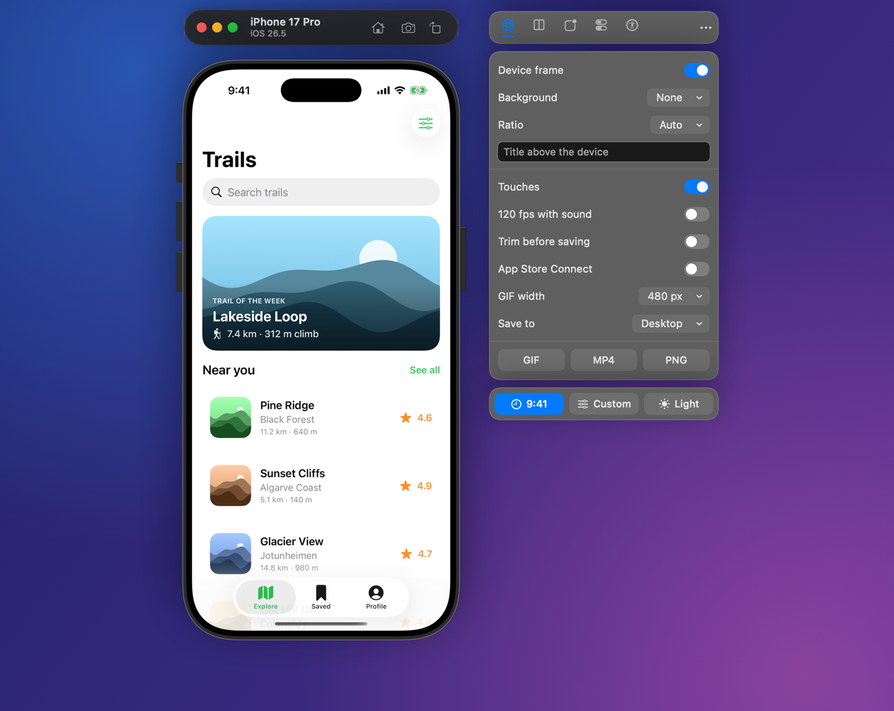
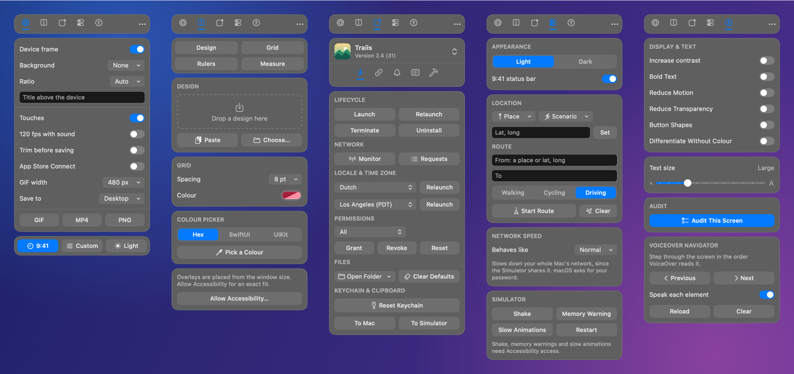
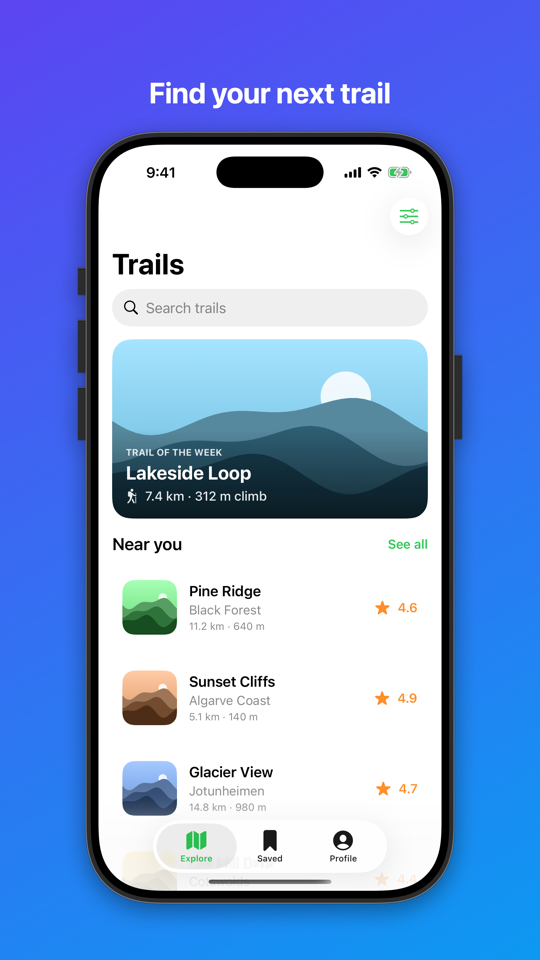
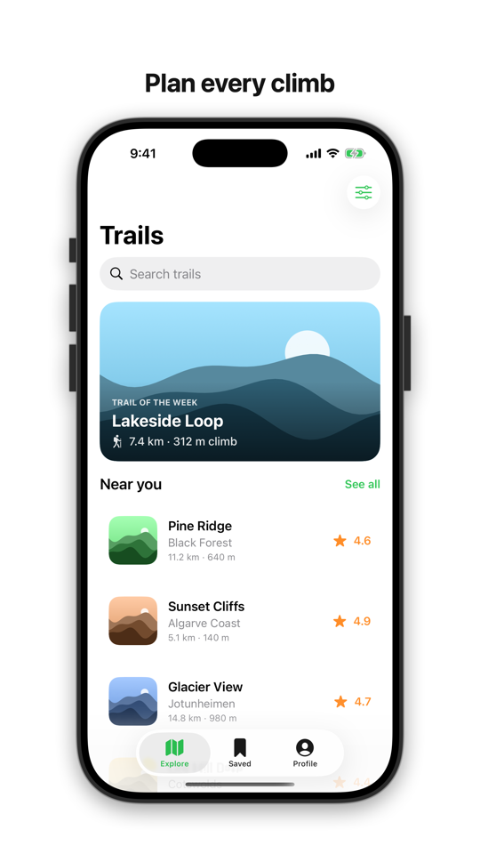
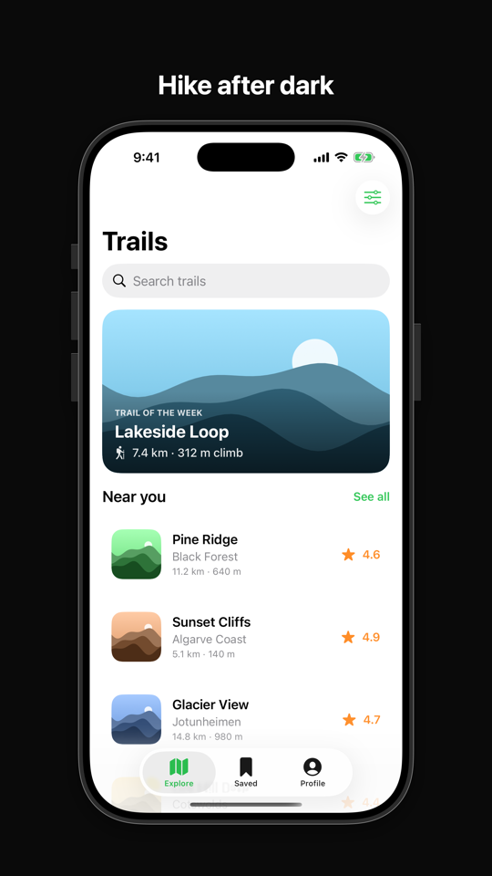
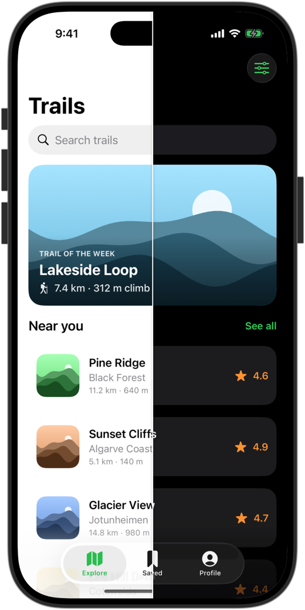
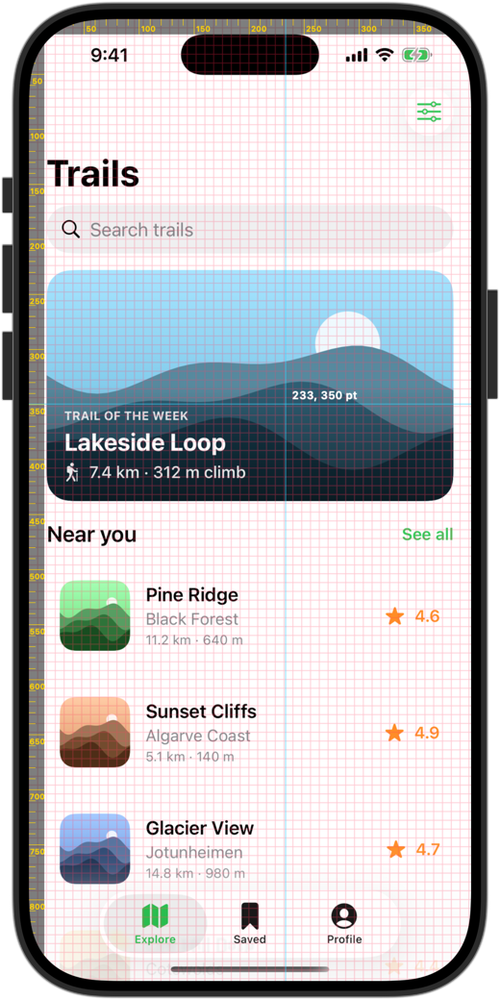
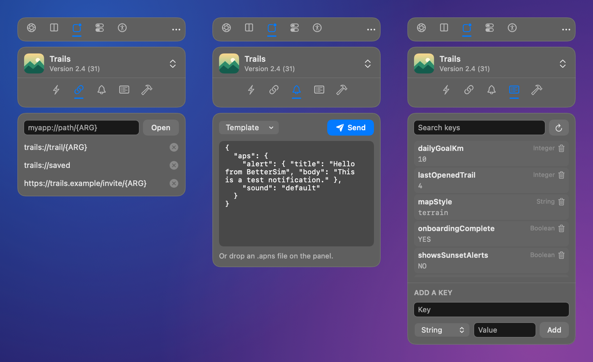
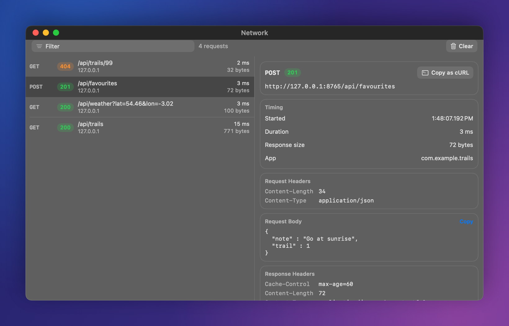
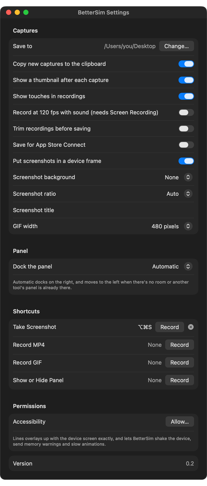

<div align="center">



# BetterSim

**A free, open-source sidekick for the iOS Simulator.**

BetterSim docks a slim panel next to the Simulator with everything you reach for while building an iOS app: framed screenshots, recordings that show your taps, design overlays, deep links, push notifications, app data, accessibility checks, a network monitor and more. It's built on Apple's own tools, so there's no account to make and nothing leaves your Mac.

[](#install)
[](Package.swift)
[](#install)
[](#install)
[](https://github.com/NCSmit/better-sim/actions/workflows/ci.yml)

</div>

## Features

The panel has five tabs, one for each part of your day.

<p align="center">
  
</p>

### Capture

- **Screenshots in the Simulator's own device frame**, side buttons included. Add a background, a shadow, an aspect ratio and a title, and they're ready for slides and store pages.
- **MP4 and GIF recordings** that show where you tapped and dragged.
- **120 fps recordings with sound**, captured from the Simulator window.
- **A trim editor** before you save, if you want one.
- **App Store Connect mode.** Screenshots come out full screen without transparency. Recordings become 30 fps app previews at the sizes Apple accepts, with a stereo audio track.
- **A thumbnail after every capture.** Drag it straight into Slack, a pull request or Xcode.
- **A clean status bar** with 9:41 and full battery, or any time, battery and signal you choose.

<table>
  <tr>
    <td width="33%"></td>
    <td width="33%"></td>
    <td width="33%"></td>
  </tr>
  <tr>
    <td align="center"><b>Gradient</b></td>
    <td align="center"><b>White</b></td>
    <td align="center"><b>Black</b></td>
  </tr>
</table>

### Compare

- **Design overlays.** Drop or paste a design over the running app. Fade it, compare side by side, mirror it, zoom it or nudge it into place.
- **A grid, rulers and a measuring tool**, all in points, with the pointer's position.
- **A colour picker** that copies the colour as hex, SwiftUI or UIKit code.

<table>
  <tr>
    <td width="50%" align="center"></td>
    <td width="50%" align="center"></td>
  </tr>
  <tr>
    <td align="center"><b>Split view, light against dark</b></td>
    <td align="center"><b>Grid, rulers and pointer position</b></td>
  </tr>
</table>

### App actions

- Launch, relaunch, terminate and uninstall. Relaunch in another language or time zone.
- **Deep links**, saved per app, with an `{ARG}` placeholder you fill in each time.
- **Push notifications** from templates or your own payloads, or drop an `.apns` file on the panel.
- **Permissions**: grant, revoke or reset each one.
- **A UserDefaults editor**, including App Group defaults.
- **App folders**: Documents, Library, Caches, the bundle and App Groups.
- **Recent builds** from DerivedData, installed with one click, and **build insights** with your average build time.
- Reset the keychain, copy the clipboard either way, and clean up DerivedData and SwiftUI preview simulators.
- **Drop files on the panel.** Apps install, photos and videos go to Photos, certificates get trusted and payloads get sent.

<p align="center">
  
</p>

### Network monitor

Relaunch your app with monitoring to see every URLSession request it makes, with method, status, headers, bodies and timings. You can copy any request as a cURL command.

<p align="center">
  
</p>

### Device settings and accessibility

- Light and dark mode, Dynamic Type, Increase Contrast, Bold Text, Reduce Motion, Reduce Transparency, Button Shapes and Differentiate Without Colour. Running apps update straight away.
- **An accessibility audit** that finds missing labels, small tap targets, duplicate labels and low text contrast.
- **A VoiceOver navigator** that steps through the screen in reading order and speaks each element.
- **Location**: places, coordinates, Apple's built-in scenarios, and real walking, cycling or driving routes from Apple Maps.
- **Network speed**: 3G, Edge, LTE, a very bad network, or no connection at all.
- Shake, memory warnings, slow animations and restarting the device.

### Physical devices

- **Mirror an iPhone or iPad connected by USB** in a window, with its sound, and take framed screenshots and recordings of it.
- Install apps, and launch, relaunch or terminate them. You can also open a link in an app.

### For AI agents and automation

A `bettersim` command-line tool can read what's on screen, tap, swipe, type, wait for text, take screenshots and change settings. It's made for AI coding agents. A browser preview shows the Simulator and lets you control it from a web page.

```bash
bettersim doctor                     # check that everything is ready
bettersim screenshot --frame         # a framed screenshot
bettersim ui                         # what's on screen, as JSON
bettersim tap --label "Sign In"      # tap an element by its label
bettersim type "hello@example.com"
bettersim wait --label "Welcome" --timeout 10
bettersim preview                    # see and control the Simulator in a browser
```

To install it, choose **Install Command-Line Tool…** in BetterSim's menu bar menu. That links `bettersim` into `~/.local/bin`. Run `bettersim --help` for every command. Commands that read or touch the screen go through the running app, so they need BetterSim to be open and allowed to use Accessibility.

## Settings

Open **Settings…** from the menu bar icon or the panel's `•••` menu. Here you choose where captures go, how screenshots look, whether recordings show touches, how the panel docks, and your global shortcuts for screenshots, recordings and the panel.

<p align="center">
  
</p>

## Install

You need macOS 14 or later and Xcode 16 or later.

```bash
git clone https://github.com/NCSmit/better-sim.git
cd better-sim
./build.sh --install
```

BetterSim appears in the menu bar. Open the Simulator and the panel docks next to it, on whichever side has room.

### Permissions

BetterSim works without any special permissions. Some features ask for one the first time you use them:

| Permission | Used for |
| --- | --- |
| Accessibility | Lining overlays up exactly with the screen, plus shake, memory warning, slow animations, the audit, the VoiceOver navigator, and taps from the command-line tool |
| Screen Recording | 120 fps recordings with sound |
| Camera and Microphone | Mirroring a connected iPhone or iPad, which macOS treats as a camera |
| Your administrator password | Network speed. macOS asks for it, and BetterSim never sees it |

## How it works

- **`xcrun simctl`** does most of the work: screenshots, recordings, push notifications, deep links, permissions, location, the status bar, appearance and Dynamic Type.
- **Device frames** come from the DeviceKit folder that Xcode installs on every Mac. BetterSim doesn't ship any Apple artwork.
- **The panel** follows the Simulator's windows through the window list, and works out where the device screen is from the window's size. With Accessibility access, it asks the Simulator directly instead.
- **Accessibility settings** are written to the device's own preferences, followed by the notification iOS apps listen for.
- **The network monitor** relaunches your app with a small library that BetterSim builds for the Simulator. The library records the app's URLSession requests and hands them to BetterSim on your Mac. Only apps you relaunch from BetterSim are monitored.
- **Network speed** uses dummynet, the traffic shaper built into macOS. The Simulator shares your Mac's network, so this slows down the whole Mac until you switch it back or quit BetterSim.

## Contributing

Bug reports, ideas and pull requests are welcome. [CONTRIBUTING.md](CONTRIBUTING.md) explains how the code fits together, how to run the tests, and how to remake the images on this page.
